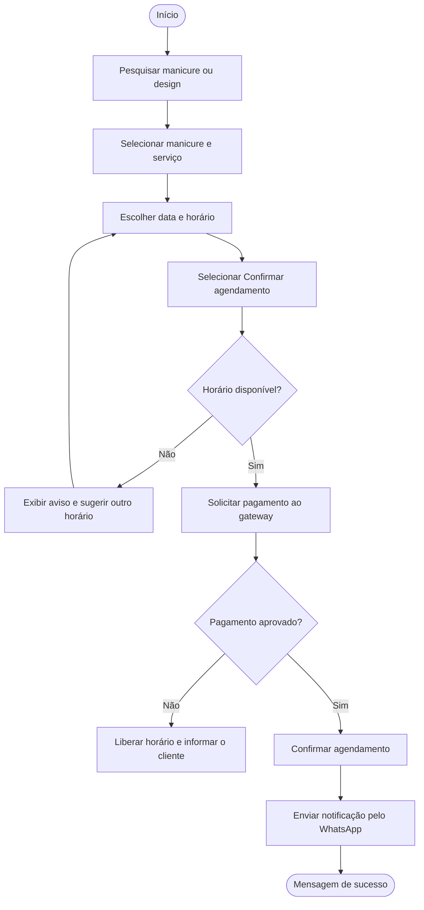

# Regra de Negócio / Fluxo

## Fluxo do Sistema - Agendamento de Serviço

### Objetivo

A funcionalidade de agendamento permite que o cliente encontre uma manicure, escolha o serviço e reserve um horário, realizando o pagamento pela própria plataforma. Este documento apresenta o fluxo realizado pelo cliente desde a pesquisa da profissional até a confirmação do agendamento e o recebimento da notificação pelo WhatsApp.

### Visão Geral

1. Acessar a plataforma e pesquisar manicures ou designs
2. Selecionar a manicure e o serviço desejado
3. Escolher a data e o horário disponíveis
4. Selecionar **Confirmar agendamento**
5. O sistema valida a disponibilidade do horário
6. O sistema solicita o pagamento ao Gateway de Pagamento
7. O cliente realiza o pagamento
8. O sistema recebe o status da transação
9. O sistema confirma o agendamento e envia a notificação pelo WhatsApp
10. O sistema apresenta a mensagem de sucesso

## Fluxo da Funcionalidade

### Pesquisa e seleção do serviço

O cliente acessa a plataforma e pesquisa por manicures ou por designs de unhas. Ao escolher uma profissional, ele visualiza os serviços oferecidos e seleciona o desejado. A tela apresenta:

- **Manicure:** nome, designs divulgados e serviços oferecidos.
- **Serviço:** descrição e valor.
- **Data e horário:** apenas os horários que a manicure disponibilizou e que ainda estão livres.

### Confirmação do agendamento

Depois de escolher a data e o horário, o cliente seleciona o botão **Confirmar agendamento**. A partir dessa ação, o sistema verifica se o horário continua livre e, estando de acordo com as regras definidas, avança para o pagamento.

### Pagamento

O sistema solicita o pagamento ao Gateway de Pagamento, que processa a transação e retorna o status. O cliente realiza o pagamento e aguarda a resposta.

### Notificação e tela de sucesso

Com o pagamento aprovado, o sistema confirma o agendamento e envia as notificações pelo WhatsApp. A tela informa que o agendamento foi concluído e mostra o resumo: manicure, serviço, data, horário e valor pago.

### Gestão pela manicure

A manicure acompanha os agendamentos recebidos no seu painel e mantém a agenda atualizada, disponibilizando ou bloqueando horários.

## Regras de negócio

| Código | Regra |
|---|---|
| RN01 | Somente manicures ativas e com horários disponíveis aparecem para agendamento. |
| RN02 | O agendamento exige serviço, manicure, data e horário. |
| RN03 | Um horário só pode ser reservado por um cliente; não pode haver agendamentos em conflito. |
| RN04 | O agendamento só é confirmado depois que o Gateway de Pagamento retorna o pagamento como aprovado. |
| RN05 | Se o pagamento for recusado ou não for concluído, o horário é liberado e o cliente é informado. |
| RN06 | Após a confirmação, o cliente e a manicure são notificados pelo WhatsApp, e o cliente recebe um lembrete antes do horário. |

!!! note "Como a arquitetura participa"
    O Front-end envia o pedido ao Back-end (HTTP / API REST), que valida as regras e consulta ou grava os dados no PostgreSQL. O Back-end solicita o pagamento ao Gateway de Pagamento e, com o pagamento aprovado, pede o envio da notificação à API do WhatsApp (Meta). Veja a página de [Arquitetura](arquitetura.md).

## Resumo do fluxo de agendamento

| Etapa | Ação do usuário | Resposta do sistema | Resultado |
|---|---|---|---|
| 01 - Pesquisa | Pesquisa manicures ou designs | Lista profissionais e designs | Cliente encontra a manicure |
| 02 - Serviço | Seleciona a manicure e o serviço | Exibe valor e horários disponíveis | Serviço escolhido |
| 03 - Horário | Escolhe data e horário | Marca o horário selecionado | Horário escolhido |
| 04 - Confirmar | Clica em **Confirmar agendamento** | Inicia a validação | Solicitação enviada |
| 05 - Validação | Aguarda o processamento | Verifica as regras RN01 a RN03 | Horário aprovado ou aviso de conflito |
| 06 - Pagamento | Realiza o pagamento | Solicita ao gateway e recebe o status (RN04, RN05) | Pagamento aprovado ou recusado |
| 07 - Confirmação | Sem ação (automático) | Confirma o agendamento e envia a notificação por WhatsApp (RN06) | Agendamento confirmado |
| 08 - Sucesso | Visualiza a confirmação | Exibe a mensagem com o resumo do agendamento | Agendamento concluído |
